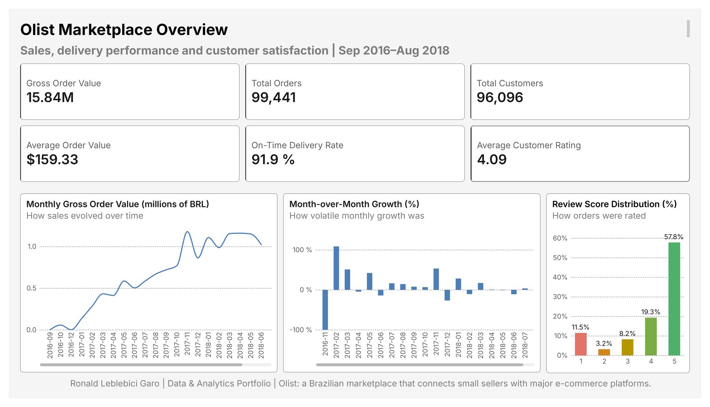
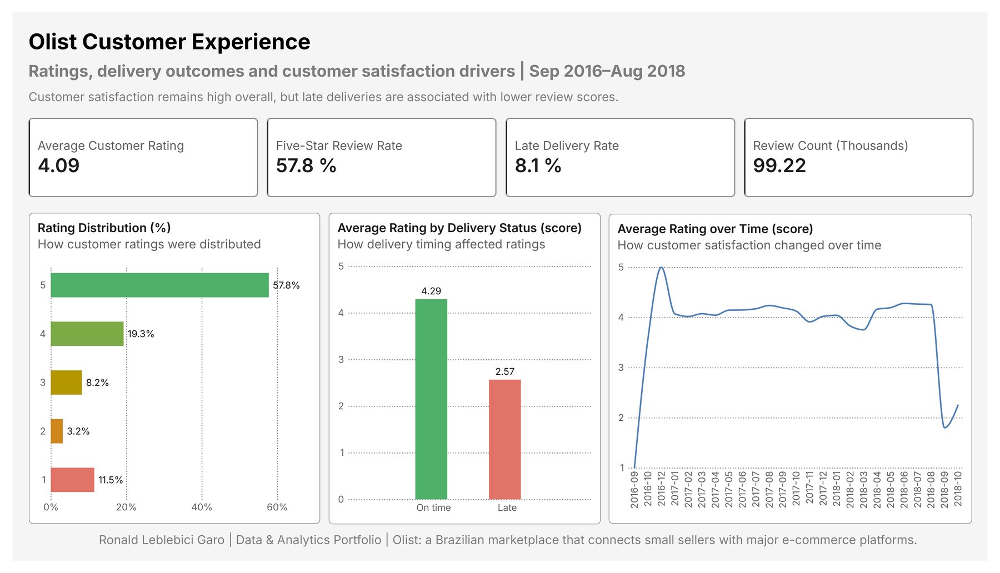
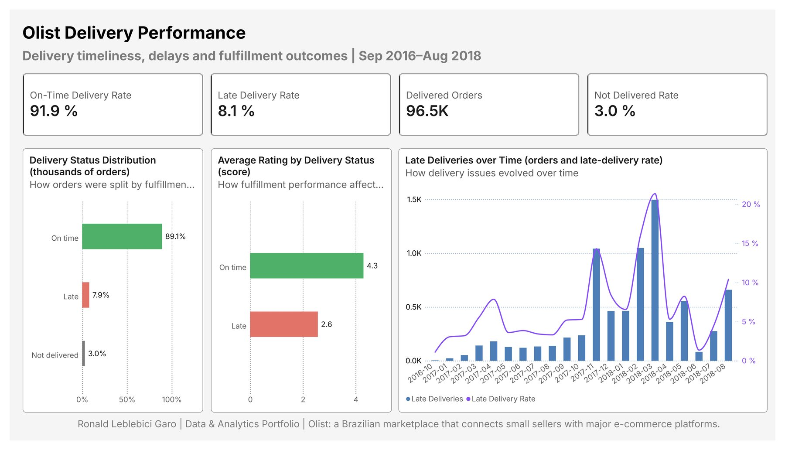
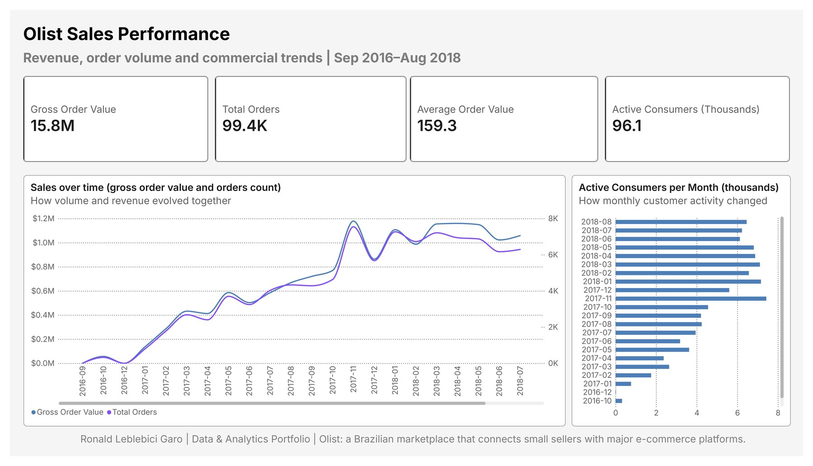
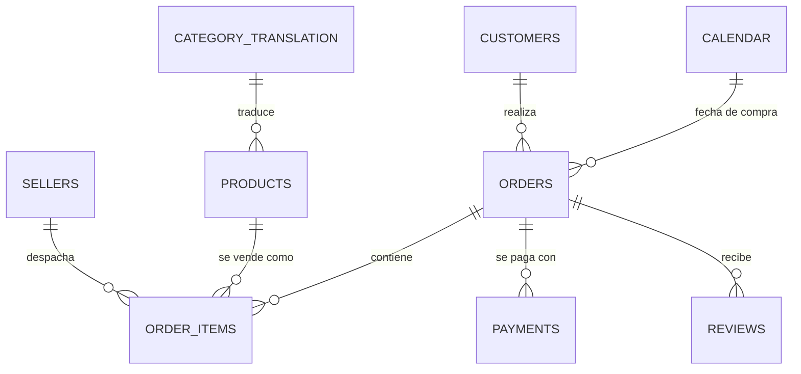

# Olist · Analítica de e-commerce

*[English](README.md)*

**Tablero ejecutivo en Power BI sobre ~100 mil pedidos reales de Olist, un marketplace de e-commerce brasileño (sep 2016 – ago 2018).** Muestra ventas, desempeño de entregas y satisfacción de clientes. La pregunta central es **cuánto dañan los atrasos en la entrega la evaluación del cliente**.



| | |
|---|---|
| **Herramientas** | Power BI Desktop · Power Query (M) · DAX · tema de informe propio (JSON) |
| **Datos** | [Brazilian E-Commerce Public Dataset by Olist](https://www.kaggle.com/datasets/olistbr/brazilian-ecommerce) · 9 tablas relacionadas · 99.441 pedidos |
| **Entregables** | [Archivo `.pbix`](powerbi/olist_ecommerce_analytics.pbix) · [PDF exportado](outputs/olist_ecommerce_dashboard.pdf) · [páginas en JPG de tamaño completo](outputs/) · [catálogo de medidas DAX](docs/dax-measures.md) |
| **Estado** | Etapa Power BI terminada. Siguen las etapas SQL y Python (ver [Próximos pasos](#próximos-pasos)). |

> El tablero está en inglés, porque apunta a reclutadores internacionales. Esta documentación está en los dos idiomas.

---

## Preguntas de negocio

1. ¿Cómo crecieron las ventas y qué tan estable fue ese crecimiento?
2. ¿Qué tan confiable es la entrega y en qué momentos falla?
3. ¿Qué tan satisfechos están los clientes y qué explica las malas evaluaciones?

## Hallazgos principales

| Métrica | Valor |
|---|---|
| Valor bruto de pedidos (productos + flete) | BRL 15,84 millones |
| Pedidos · clientes únicos | 99.441 · 96.096 |
| Ticket promedio | BRL 159,33 |
| Entregas a tiempo (sobre pedidos entregados) | 91,9 % |
| Pedidos nunca entregados (sobre el total) | 3,0 % |
| Evaluación promedio · porcentaje de 5 estrellas | 4,09 · 57,8 % |

- **Los atrasos van muy de la mano con las malas evaluaciones.** Los pedidos a tiempo promedian **4,29** estrellas y los atrasados **2,57**. En los pedidos atrasados, el **54 %** de las reseñas son de 1–2 estrellas, contra el **9 %** en los pedidos a tiempo. Los pedidos no entregados son los peor evaluados, con 1,76. Son asociaciones, no efectos causales: los pedidos atrasados también pueden ser distintos en producto, región o vendedor.
- **Crecimiento rápido y después estable.** El valor bruto mensual partió casi en cero a fines de 2016 y llegó a un máximo de cerca de BRL 1,2 millones en **noviembre de 2017** (Black Friday). Después se mantuvo entre BRL 1,0 y 1,2 millones al mes hasta mediados de 2018.
- **La entrega falla cuando hay más volumen.** La tasa de atraso saltó en noviembre de 2017 (cerca de 14 %) y en febrero–marzo de 2018 (hasta cerca de 21 %). O sea, la capacidad logística es un riesgo operativo clave, no solo la demanda.
- **Los clientes casi no vuelven a comprar.** Solo el **3,1 %** de los clientes únicos hizo más de un pedido (1,03 pedidos por cliente). La cifra sale de la medida `Repeat Customer Rate` del modelo y es el punto de partida de la próxima etapa (cohortes y recompra).

## Páginas del tablero

| Página | Qué responde | |
|---|---|---|
| **1 · Overview** | KPI principales, tendencia mensual de ventas, crecimiento mes a mes, distribución de evaluaciones | [ver](docs/img/1_overview.jpg) |
| **2 · Customer Experience** | Distribución de notas, nota según estado de entrega, satisfacción en el tiempo | [ver](docs/img/2_experience.jpg) |
| **3 · Delivery Performance** | Reparto entre a tiempo / atrasado / no entregado, y pedidos y tasa de atraso por mes (gráfico combinado, dos ejes) | [ver](docs/img/3_delivery.jpg) |
| **4 · Sales Performance** | Ventas y cantidad de pedidos en el tiempo (dos ejes), consumidores activos por mes | [ver](docs/img/4_sales.jpg) |

<details>
<summary>Ver las otras tres páginas</summary>





</details>

## Modelo de datos

`Orders` es la tabla central. Todas las relaciones son de uno a varios y filtran en una sola dirección. Una tabla `Calendar` propia (marcada como tabla de fechas) sostiene las medidas de inteligencia de tiempo.



**Decisiones de modelado**

- **Tabla de medidas aparte.** Las 40 medidas viven en `_Measures`, ordenadas en carpetas (Sales, Time, Customers, Delivery, Reviews, Validation, Core Counts). Ninguna queda repartida entre las tablas de datos.
- **Columnas calculadas solo donde hace falta una etiqueta por fila.** `Orders[Delivery Status]` (On time / Late / Not delivered) y `Orders[Order Purchase Date]` (la clave de fecha para la relación con `Calendar`).
- **Filtro bidireccional solo dentro de una medida.** `Active Consumers` usa `CROSSFILTER(..., BOTH)` dentro de su fórmula, en vez de una relación bidireccional en todo el modelo. Así los filtros no se propagan en direcciones ambiguas.
- **Power Query:** los tipos de datos se fijan con la configuración regional de cada fuente (`en-US` en columnas de moneda, lo que evita errores de separador decimal en un equipo configurado en español), y la columna de nota se renombra para que se lea mejor.

## Definición de métricas

| Métrica | Definición |
|---|---|
| Gross Order Value (GOV) | `SUM(price) + SUM(freight_value)` de `Order Items` |
| Average Order Value | GOV ÷ pedidos distintos |
| On-Time Delivery Rate | Pedidos entregados con `fecha_entrega ≤ fecha_estimada` ÷ pedidos **entregados** |
| Late Delivery Rate | Pedidos entregados con `fecha_entrega > fecha_estimada` ÷ pedidos **entregados** |
| Not Delivered Rate | Pedidos sin fecha de entrega al cliente ÷ **todos** los pedidos |
| Five-Star Review Rate | Reseñas con nota 5 ÷ total de reseñas |
| GOV Growth MoM % | `DIVIDE(GOV − GOV del mes anterior, GOV del mes anterior)` con `DATEADD` sobre `Calendar` |
| Repeat Customer Rate | Clientes únicos (`customer_unique_id`) con más de un pedido ÷ clientes únicos |

Los denominadores son distintos a propósito. Por eso la página 3 muestra 89,1 % / 7,9 % / 3,0 % sobre el **total** de pedidos, mientras que las tarjetas muestran 91,9 % / 8,1 % sobre los pedidos **entregados**. Las dos cifras son correctas.

Un par de medidas de ejemplo (el listado completo está en [`docs/dax-measures.md`](docs/dax-measures.md)):

```dax
On-Time Delivery Rate =
DIVIDE (
    CALCULATE ( [Total Orders],
        FILTER ( Orders,
            NOT ISBLANK ( Orders[order_delivered_customer_date] )
                && Orders[order_delivered_customer_date] <= Orders[order_estimated_delivery_date] ) ),
    CALCULATE ( [Total Orders],
        FILTER ( Orders, NOT ISBLANK ( Orders[order_delivered_customer_date] ) ) )
)

GOV Growth MoM % =
DIVIDE ( [Gross Order Value] - [Previous Month GOV], [Previous Month GOV] )
```

**Validación.** La carpeta `06 Validation` tiene medidas de control. Por ejemplo, comprueba que el promedio ponderado de las notas a tiempo y atrasadas coincida con la nota general de los pedidos entregados, y compara el GOV con el total pagado (los pagos resultan cerca de 1,0 % más altos que el GOV). Las cifras principales de esta página también se compararon con los CSV originales.

## Diseño

- **Tema de informe propio** ([`powerbi/theme/Ronald_Portfolio_Light.json`](powerbi/theme/Ronald_Portfolio_Light.json)). Los colores salen de una sola paleta construida en OKLCH, un espacio de color donde números iguales se ven igual de claros. Los colores de texto cumplen el estándar de contraste WCAG AA, y los colores de las series se probaron frente a los tipos comunes de daltonismo.
- **Los colores tienen significado.** Verde, amarillo-naranjo y rojo siempre indican bueno, neutro y malo (escala de notas, estado de entrega). El azul marino y el morado de la marca se usan para tendencias sin juicio de valor.
- **Cada gráfico dice qué pregunta responde.** Cada visual tiene un subtítulo con su pregunta ("How delivery timing affected ratings"), y todas las páginas comparten el mismo encabezado y pie.
- Tipografía: **Inter**, la misma de mi CV y mi LinkedIn.

## Advertencias sobre los datos

- **Bordes con pocos datos.** Septiembre y diciembre de 2016 tienen entre 1 y 4 pedidos, y septiembre–octubre de 2018 suman 20. Los promedios mensuales en esos meses (por ejemplo, la caída de la nota al final de la página 2) son ruido, no tendencia.
- **"Not delivered"** junta pedidos cancelados, no disponibles y todavía en tránsito (los que no tienen fecha de entrega al cliente).
- **Los montos** están en reales brasileños (BRL), sin ajuste por inflación.
- Son datos comerciales reales, anonimizados por Olist. Cubren solo los pedidos hechos a través de Olist, no todo el e-commerce de Brasil.

## Cómo reproducirlo

1. Descarga el dataset desde [Kaggle](https://www.kaggle.com/datasets/olistbr/brazilian-ecommerce) y descomprime los 9 CSV en `data/raw/`. Los datos crudos no se versionan en este repositorio; ver `.gitignore`.
2. Abre `powerbi/olist_ecommerce_analytics.pbix` en Power BI Desktop (gratis, Windows).
3. Si tu carpeta es otra, ve a **Transformar datos → Configuración de origen de datos → Cambiar origen…** y apunta cada consulta a tu `data/raw/`. Después haz clic en **Actualizar**.

## Estructura del repositorio

```
olist-ecommerce-analytics/
├── powerbi/
│   ├── olist_ecommerce_analytics.pbix   # informe + modelo de datos
│   └── theme/Ronald_Portfolio_Light.json
├── outputs/                             # páginas en JPG de tamaño completo + PDF
├── docs/
│   ├── dax-measures.md                  # todas las medidas DAX, por carpeta
│   └── img/                             # capturas livianas para este README
└── data/raw/                            # CSV de Olist (no versionados)
```

## Próximos pasos

Este repositorio es el proyecto principal de mi portafolio de datos y avanza por etapas:

- [x] **Power BI:** modelo de datos, medidas DAX, tablero ejecutivo de 4 páginas
- [ ] **SQL (DuckDB):** esquema estrella con tablas de hechos y dimensiones; consultas de KPI (cohortes, recompra, tiempos de entrega)
- [ ] **Python (pandas):** ETL y los mismos KPI, lado a lado con las versiones en SQL, en `comparisons/`
- [ ] **Excel:** un KPI rehecho con Power Query y una tabla dinámica
- [ ] **Análisis más profundo:** ¿el castigo en la nota por atraso cambia según cuántos días de atraso hubo, la categoría del producto o la región del vendedor?

## Autor

**Ronald Leblebici Garo** · Ingeniero Civil Industrial y Magíster en Economía · Santiago, Chile
[LinkedIn](https://www.linkedin.com/in/ronald-leblebici-garo) · [GitHub](https://github.com/ronald-lg)

*Los datos son de Olist y están publicados en Kaggle bajo licencia [CC BY-NC-SA 4.0](https://creativecommons.org/licenses/by-nc-sa/4.0/). El código y la documentación de este repositorio están bajo licencia MIT.*
