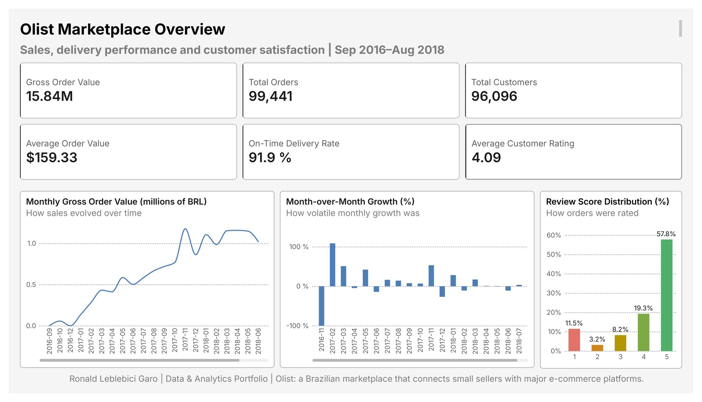
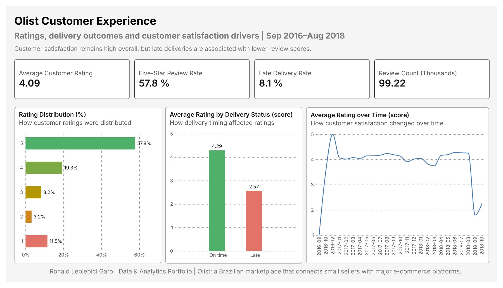
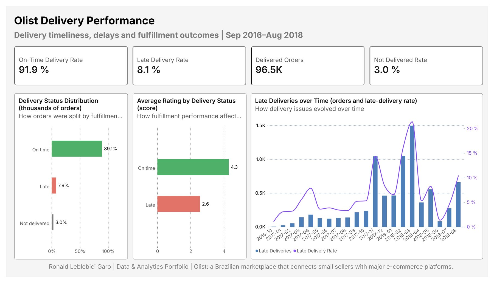
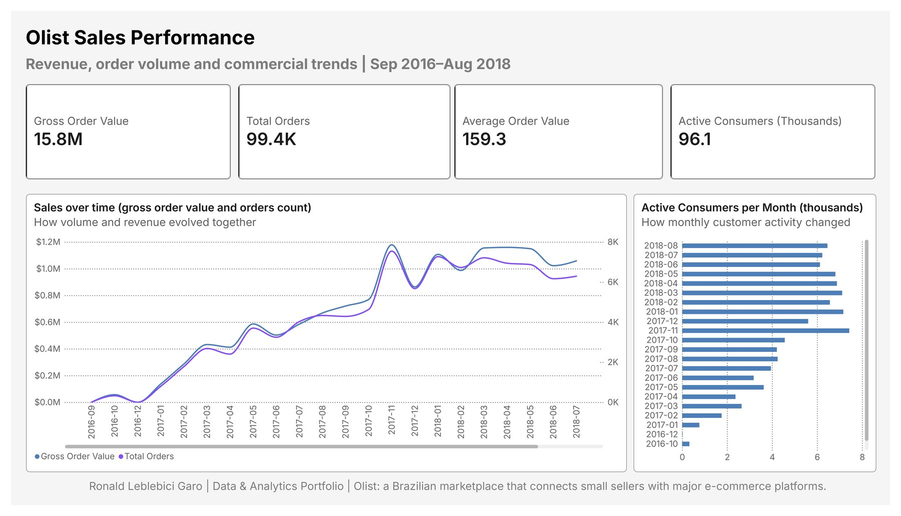
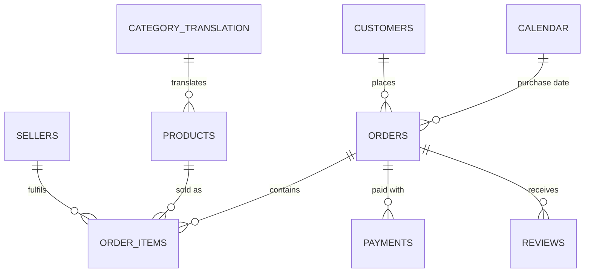

# Olist · E-commerce Analytics

*[Español](README.es.md)*

**Executive Power BI dashboard on ~100k real orders from Olist, a Brazilian e-commerce marketplace (Sep 2016 – Aug 2018).** It tracks sales, delivery performance and customer satisfaction. The main question is **how much late deliveries hurt customer ratings**.



| | |
|---|---|
| **Tools** | Power BI Desktop · Power Query (M) · DAX · custom report theme (JSON) |
| **Data** | [Brazilian E-Commerce Public Dataset by Olist](https://www.kaggle.com/datasets/olistbr/brazilian-ecommerce) · 9 related tables · 99,441 orders |
| **Deliverables** | [`.pbix` file](powerbi/olist_ecommerce_analytics.pbix) · [PDF export](outputs/olist_ecommerce_dashboard.pdf) · [full-size JPG pages](outputs/) · [DAX measure catalogue](docs/dax-measures.md) |
| **Status** | Power BI stage complete. SQL and Python stages are next (see [Roadmap](#roadmap)). |

---

## Business questions

1. How did sales grow, and how steady was that growth?
2. How reliable is delivery, and when does it break down?
3. How satisfied are customers, and what drives bad reviews?

## Key findings

| Metric | Value |
|---|---|
| Gross order value (items + freight) | BRL 15.84M |
| Orders · unique customers | 99,441 · 96,096 |
| Average order value | BRL 159.33 |
| On-time delivery rate (of delivered orders) | 91.9% |
| Orders never delivered (of all orders) | 3.0% |
| Average rating · five-star share | 4.09 · 57.8% |

- **Late deliveries are strongly linked to bad reviews.** On-time orders average **4.29** stars and late orders **2.57**. Among late orders, **54%** of reviews are 1–2 stars, compared with **9%** for on-time orders. Undelivered orders do worst of all, at 1.76 stars. These are associations, not causal estimates: late orders may also differ in product, region or seller.
- **Growth was fast, then leveled off.** Monthly gross order value went from near zero in late 2016 to a peak of about BRL 1.2M in **November 2017** (Black Friday). It then stayed around BRL 1.0–1.2M per month through mid-2018.
- **Delivery breaks down when volume peaks.** The late-delivery rate jumped in November 2017 (about 14%) and in February–March 2018 (about 21% at its highest). So logistics capacity, not just demand, is a key operational risk.
- **Customers almost never come back.** Only **3.1%** of unique customers ordered more than once (1.03 orders per customer). This comes from the model's `Repeat Customer Rate` measure and is the starting point for the next stage (cohorts and repeat purchases).

## Dashboard pages

| Page | What it answers | |
|---|---|---|
| **1 · Overview** | Headline KPIs, monthly sales trend, month-over-month growth, rating distribution | [view](docs/img/1_overview.jpg) |
| **2 · Customer Experience** | Rating mix, rating by delivery status, satisfaction over time | [view](docs/img/2_experience.jpg) |
| **3 · Delivery Performance** | On-time / late / not delivered split, and late orders and late rate by month (combo chart, two axes) | [view](docs/img/3_delivery.jpg) |
| **4 · Sales Performance** | Sales value and order count over time (two axes), active consumers per month | [view](docs/img/4_sales.jpg) |

<details>
<summary>Show the other three pages</summary>





</details>

## Data model

`Orders` is the central table. Every relationship is one-to-many with single-direction filtering. A separate `Calendar` table (marked as a date table) supports the time-intelligence measures.



**Modeling choices**

- **Separate measures table.** All 44 measures live in `_Measures`, grouped into display folders (Sales, Time, Customers, Delivery, Reviews, Validation, Core Counts). None are left scattered across the data tables.
- **Calculated columns only where a row-level label is needed.** `Orders[Delivery Status]` (On time / Late / Not delivered) and `Orders[Order Purchase Date]` (the date key for the `Calendar` relationship).
- **Bidirectional filtering only inside one measure.** `Active Consumers` uses `CROSSFILTER(..., BOTH)` inside its formula instead of a model-wide bidirectional relationship, so filters can't spread in ambiguous directions.
- **Power Query:** data types are set per locale (`en-US` for currency columns, which avoids decimal-separator errors on a Spanish-locale machine), and the review score column is renamed for readability.

## Metric definitions

| Metric | Definition |
|---|---|
| Gross Order Value (GOV) | `SUM(price) + SUM(freight_value)` from `Order Items` |
| Average Order Value | GOV ÷ distinct orders |
| On-Time Delivery Rate | Delivered orders with `delivered_date ≤ estimated_date` ÷ **delivered** orders |
| Late Delivery Rate | Delivered orders with `delivered_date > estimated_date` ÷ **delivered** orders |
| Not Delivered Rate | Orders with no customer delivery date ÷ **all** orders |
| Five-Star Review Rate | Reviews with score = 5 ÷ all reviews |
| GOV Growth MoM % | `DIVIDE(GOV − GOV previous month, GOV previous month)` using `DATEADD` over `Calendar` |
| Repeat Customer Rate | Unique customers (`customer_unique_id`) with more than one order ÷ unique customers |

The denominators differ on purpose. That's why page 3 shows 89.1% / 7.9% / 3.0% as a share of **all** orders, while the KPI cards show 91.9% / 8.1% as a share of **delivered** orders. Both are correct.

Key DAX, as an example (the full list is in [`docs/dax-measures.md`](docs/dax-measures.md)):

```dax
On-Time Delivery Rate =
DIVIDE (
    CALCULATE ( [Total Orders],
        FILTER ( Orders,
            NOT ISBLANK ( Orders[order_delivered_customer_date] )
                && Orders[order_delivered_customer_date] <= Orders[order_estimated_delivery_date] ) ),
    CALCULATE ( [Total Orders],
        FILTER ( Orders, NOT ISBLANK ( Orders[order_delivered_customer_date] ) ) )
)

GOV Growth MoM % =
DIVIDE ( [Gross Order Value] - [Previous Month GOV], [Previous Month GOV] )
```

**Validation.** The `06 Validation` folder holds sanity-check measures. For example, it checks that the weighted average of on-time and late ratings matches the overall rating for delivered orders, and it compares GOV with total payments (payments come out about 1.0% higher than GOV). The headline figures on this page were also cross-checked against the raw CSV files.

## Design

- **Custom report theme** ([`powerbi/theme/Ronald_Portfolio_Light.json`](powerbi/theme/Ronald_Portfolio_Light.json)). The colors come from one palette built in OKLCH, a color space where equal numbers look equally light. Text colors pass the WCAG AA contrast standard, and the series colors were checked against the common types of color blindness.
- **Colors carry meaning.** Green, yellow-orange and red always mean good, neutral and bad (rating scale, delivery status). Brand navy and purple are used for plain trends.
- **Every chart states its question.** Each visual has a subtitle saying what it answers ("How delivery timing affected ratings"), and every page has the same header and footer.
- Typeface: **Inter**, the same one used in my CV and LinkedIn.

## Data caveats

- **Thin edges.** September and December 2016 have 1–4 orders, and September–October 2018 have 20 orders in total. Monthly averages there (for example, the rating drop at the end of page 2) are noise, not a trend.
- **"Not delivered"** combines canceled, unavailable and still-in-transit orders (orders with no customer delivery date).
- **Amounts** are in Brazilian reais (BRL), not adjusted for inflation.
- The data is real commercial data, anonymized by Olist. It covers orders placed through Olist only, not the whole Brazilian e-commerce market.

## How to reproduce

1. Download the dataset from [Kaggle](https://www.kaggle.com/datasets/olistbr/brazilian-ecommerce) and unzip the 9 CSV files into `data/raw/`. The raw data isn't versioned in this repo; see `.gitignore`.
2. Open `powerbi/olist_ecommerce_analytics.pbix` in Power BI Desktop (free, Windows).
3. If your folder path is different, go to **Transform data → Data source settings → Change source…** and point each query to your `data/raw/` folder. Then click **Refresh**.

## Repository structure

```
olist-ecommerce-analytics/
├── powerbi/
│   ├── olist_ecommerce_analytics.pbix   # report + data model
│   └── theme/Ronald_Portfolio_Light.json
├── outputs/                             # full-size page exports (JPG) + PDF
├── docs/
│   ├── dax-measures.md                  # every DAX measure, grouped by folder
│   └── img/                             # web-sized screenshots for this README
└── data/raw/                            # Olist CSVs (not versioned)
```

## Roadmap

This repository is the flagship of my Data/Analytics portfolio and is growing in stages:

- [x] **Power BI:** data model, DAX measures, 4-page executive dashboard
- [ ] **SQL (DuckDB):** star schema with fact and dimension tables; KPI queries (cohorts, repeat purchases, delivery times)
- [ ] **Python (pandas):** ETL and the same KPIs, side by side with the SQL versions in `comparisons/`
- [ ] **Excel:** one KPI rebuilt with Power Query and a pivot table
- [ ] **Deeper analysis:** does the rating penalty from late delivery change with how late the order is, the product category or the seller's region?

## Author

**Ronald Leblebici Garo** · Civil Industrial Engineer & M.A. in Economics · Santiago, Chile
[LinkedIn](https://www.linkedin.com/in/ronald-leblebici-garo) · [GitHub](https://github.com/ronald-lg)

*The data comes from Olist and is published on Kaggle under [CC BY-NC-SA 4.0](https://creativecommons.org/licenses/by-nc-sa/4.0/). The code and documentation in this repository are under the MIT License.*
